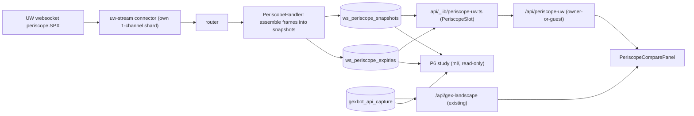

# UW Periscope websocket capture (S1)

**Date:** 2026-10-29
**Status:** Plan. Nothing built yet. This is phase S1 of
`docs/superpowers/specs/gexbot-refresh-2026-10-28.md` ("D1 revised").
**Supersedes:** the Periscope parts of
`docs/superpowers/specs/uw-api-ws-alignment-2026-10-23.md` (the two
`ws_periscope_*` tables in W1, and task W5) and of its plan
`docs/superpowers/plans/2026-10-23-uw-ws-capture.md`. The other W tasks in
that plan are out of scope here. None of them is built either.

## Goal

Capture UW's live market-maker Periscope board (websocket `periscope:SPX`)
into its own tables via `uw-stream/`, serve it to owner and guests, and show
it next to GEXBot while trading, so the owner can learn how each source should
inform trades.

## Why

- UW Periscope is a **market-maker position** estimate per strike. GEXBot
  State is a classified **taker flow** imbalance. On 2026-05-26 their
  per-strike Spearman was ≈ +0.04 (208 slice pairs). They are different
  measurements, not one measurement with opposite signs.
- Owner decision (2026-10-29, "D1 revised"): keep the sources separate, with
  separate rules, and compare them live.
- Nothing in this repo has held UW Periscope values since the scraper
  stopped on 2026-05-26. `periscope_snapshots` has been GEXBot-fed since then.
- The channel has no REST endpoint and no backfill. Every session we don't
  capture is lost, so P1 to P3 come first and should ship fast.
- The owner rule "websocket over REST" is met trivially: there is no REST
  equivalent and no cron to retire.

## What exists today (checked 2026-10-29)

- **10-23 W1/W5 were never built.** No `ws_periscope_*` migration exists on
  `main` or on any branch. `main` is at migration #191. The in-flight branches
  share #192–#197: gexbot dedupe, futures_bars order flow,
  `periscope_snapshots.source`, gexbot_eod_reports, futures_blocks and
  multi-leg anchors. The `fix/2026-10-23-uw-ws` branch and worktree no longer
  exist.
- **`uw-stream` on `main`.** `channel_registry.py` holds the exact names
  `flow-alerts`, `off_lit_trades` and `futures_trades`, and the prefixes
  `option_trades:`, `gex_strike_expiry:` and `net_flow:`. There is no
  periscope entry. The handshake sends no User-Agent. A bare UW error frame
  (`{"error": …}`) is logged only as a rate-limited `malformed_envelope`
  (10-23 defect D15, not fixed).
- **Prod:** no `ws_periscope_snapshots` table, per the owner session on
  2026-10-29 (gexbot-refresh spec). This session did not re-check it: the
  read-only prod query was denied. P1 re-checks.
- **Scraper-era storage:** `periscope_snapshots` (#140, #141, #194) stores
  long rows `(captured_at, expiry, panel ∈ gamma|charm|vanna|positions,
strike INT, value NUMERIC(14,2), timeframe, source)`, keyed
  `UNIQUE (captured_at, expiry, panel, strike)`. The scraper captured 0DTE
  every 10 min during RTH.
- **Reusable read path:**
  - `PeriscopeSlot`, `computePeriscopeView` and `formatPeriscopeForClaude`
    in `api/_lib/periscope-format.ts`;
  - `mergeStrikes` in `api/periscope-strikes.ts`;
  - `fetchSpxSpot`, `endOfMinute`, `DATE_RE` and `TIME_RE` in
    `api/_lib/periscope-query.ts`.

  Readers today: `/api/periscope-exposure` and `/api/periscope-strikes`
  (from `periscope_snapshots`), and `/api/periscope-map` and
  `/api/gex-landscape` (GEXBot 1-min, from `gexbot_api_capture`).

## The `periscope:<TICKER>` frame

### Known

Sources: UW's channel page `https://api.unusualwhales.com/docs/websocket/periscope.md`
and the overview's "Periscope values" section, both fetched 2026-10-29.
Also UW's own example `unusual-whales/api-examples/examples/ws-stream-periscope-greek-exposure`,
whose README, log and `raw_sample.jsonl` come from a real run on 2026-08-20.

| Fact          | Value                                                                                                                                                                                              |
| ------------- | -------------------------------------------------------------------------------------------------------------------------------------------------------------------------------------------------- |
| Join          | `{"channel":"periscope:SPX","msg_type":"join"}`. Ack: `["<channel>", {"response": {}, "status": "ok"}]`                                                                                            |
| Envelope      | `["periscope:SPX", {ticker, timestamp, total_rows, has_more, rows}]`. The global `periscope` sends the same object, tagged `"periscope"`, for SPX, VIX, XSP and NANOS                              |
| `timestamp`   | ms epoch, **minute-aligned**, shared by every frame of one snapshot and by every ticker in the same cycle                                                                                          |
| Chunking      | Up to 1,024 rows per frame. `has_more` is `true` on every frame except the last. Σ`rows` across frames with the same `timestamp` = `total_rows`                                                    |
| Row           | `{"strike": "<decimal string>", "expiry": "YYYY-MM-DD", "gamma": <float>, "charm": <float>, "vanna": <float>}`. In UW's sample the greeks are JSON numbers and strike/expiry are strings. No nulls |
| Meaning       | **Net** market-maker exposure (puts + calls combined). UW will not distribute contract counts by strike, so there is **no Positions panel**                                                        |
| Scale         | Not the dollarized `*_per_one_percent_move_oi` scale of REST spot-exposures. UW: "do not compare them directly"                                                                                    |
| Cadence       | One snapshot every 60 s, **around the clock**. Each one is delivered ≈ 71 s after its `timestamp`, and all its frames land within ≈ 0.1 s                                                          |
| Order         | Rows within a frame are **unsorted**: mixed expiries and strikes                                                                                                                                   |
| Size          | SPX 16,375–16,388 rows (17 frames) off-hours on 2026-08-20. UW engineering puts the in-session ceiling near **30,000**. XSP ≈ 4,150, VIX ≈ 130, NANOS 36                                           |
| Zero rows     | ≈ 46% of SPX rows have gamma = charm = vanna = 0, all at far strikes and distant expiries                                                                                                          |
| Rejoin        | After a fresh join the server **restarts the current snapshot from its first frame**, so rows already received arrive again                                                                        |
| Concentration | The front two expiries carry ≈ 87% of \|charm\| and ≈ 38% of \|gamma\| (31 SPX snapshots, pre-market)                                                                                              |
| Entitlement   | Advanced plan for personal use. **Not available on Enterprise / Enterprise-Startup**: joining returns an error                                                                                     |

### Unknown, and how each gets settled

None of these blocks the capture. The handler is built to tolerate all of
them, and nothing reads the table until P3's checks pass.

| Unknown                                                                                                                                | Settled by                                                                        |
| -------------------------------------------------------------------------------------------------------------------------------------- | --------------------------------------------------------------------------------- |
| Units of gamma/charm/vanna, and whether they equal the values on UW's web Periscope (and so the scraper-era magnitudes)                | P3 owner screenshot parity check. P6a distribution check against scraper-era rows |
| Sign convention (assumed: + = MMs net long gamma, like the web UI's green bar)                                                         | Same screenshot check                                                             |
| Whether a 1-min snapshot equals the web UI's 10-min slice at :00/:10/…                                                                 | Same screenshot check                                                             |
| In-session `total_rows`, non-zero share, expiries per snapshot (UW's example counts 302 SPX expiries; this repo has not verified that) | P3 SQL checks after the first session                                             |
| Holiday and weekend publishing                                                                                                         | P3 header rows over the first weekend                                             |
| Exact error-frame shape when a join is refused                                                                                         | P2a handles both a bare `{"error": …}` and an enveloped `[channel, {"error": …}]` |
| Greeks ever sent as strings                                                                                                            | Accept both, as the 10-23 plan already required                                   |

**No local probe.** The docs and UW's raw sample give the frame shape, so the
first production join (P3) is the probe. A local probe would need a **second
UW token**: the prod key connected from a second machine drops prod's sockets.
See open question Q8.

## Decisions

### ADR-1: Separate tables, not a `source` value in `periscope_snapshots`

**Context.** `periscope_snapshots` is keyed
`UNIQUE (captured_at, expiry, panel, strike)` with no `source` column in the
key. About a dozen `api/` modules read it (lottery detectors, gamma
detector, analyze context, periscope-exposure/strikes, the populate cron).
The slot loaders pick `MAX(captured_at) WHERE expiry = …` with no source
filter.

**Decision.** New tables `ws_periscope_snapshots` (one row per snapshot) and
`ws_periscope_expiries` (one row per snapshot × expiry, with arrays).

**Alternatives.**

- _A `source = 'uw_ws'` value in `periscope_snapshots`._ UW rows would
  interleave at 1 min with GEXBot rows at 10 min. Every existing reader would
  silently start switching vendor slot by slot, which is the mixing D1 revised
  forbids. Fixing that means a source filter in every reader and a unique-key
  rebuild on a large live table. Also, `NUMERIC(14,2)` long rows at 16–30K
  strikes × 3 greeks × 1,440 snapshots/day is about 20–40M rows/day.

**Consequences.**

- Existing panels and rules keep reading GEXBot/scraper data, unchanged.
- UW data reaches the UI only through new, explicitly labelled readers.

### ADR-2: One row per snapshot × expiry, `REAL[]` arrays

**Decision.** For each expiry, the strike-sorted arrays `strikes`, `gamma`,
`charm` and `vanna` (float4). All-zero rows are dropped. A byte-identical
consecutive snapshot stores a header only. This is the 10-02 owner decision
(compact arrays, zero-drop, dedupe).

**Trade-off.** Float4 keeps about 7 significant digits, which is plenty for
ranking, sign and correlation. The cost is that per-strike SQL needs
`unnest`. That is acceptable: readers load one expiry row per snapshot.

### ADR-3: Join `periscope:SPX`, on its own shard

**Decision.** Use the per-ticker channel. `Settings.channel_shards` is
family-contiguous, so the single `periscope:` channel gets its own
connection.

**Alternative.** The global `periscope` channel folds into "the first shard
with room". Today that is the second `option_trades` shard, a firehose. The
planned global `futures_blocks` puts 4 globals there (41 + 4 = 45, at the
cap). A fifth global spills every global onto a new shard anyway, and it
would carry XSP/VIX/NANOS bytes we filter out.

**Consequences.**

- Isolation: a slow-client drop on a firehose socket can't take Periscope
  with it.
- Cost: one more connection. That is an estimated 7 of the ~10 per token
  (see Data dependencies).

### ADR-4: The UW reader returns the existing panel shapes

**Decision.** `api/_lib/periscope-uw.ts` builds the existing `PeriscopeSlot`
type. `/api/periscope-uw` then returns:

- a `view` from the same `computePeriscopeView` that `/api/periscope-exposure`
  uses;
- `strikes` rows that are a superset of `/api/periscope-strikes`
  (`strike, gamma, charm` plus `vanna`).

Any existing panel could later be pointed at UW with no new view code (Q10).
This spec does not repoint any of them.

### ADR-5: A dedicated side-by-side panel, with metrics computed client-side

**Decision.** A new panel reads `/api/periscope-uw` plus the existing GEXBot
`/api/gex-landscape` (per strike, 1 min, `?at=` scrub). A pure util,
`src/utils/periscope-compare.ts`, computes the agreement.

**Alternatives.**

- _Overlay UW markers on the GEX Landscape._ That puts two different units
  and meanings on one axis, and invites reading them as one measurement.
- _A server-side `/api/periscope-compare`._ That needs extracting the GEXBot
  slot readers out of `periscope-map.ts` plus another endpoint, for no gain
  in a live view. The P6 study recomputes the metrics from stored rows anyway.

## Architecture



## Phases

Run one implementer stream at a time, in this order. P6a is read-only and can
run any time after P1. Sizes: S ≈ half a day, M ≈ 1 day.

| Phase | Scope                                                                                                                    | Size                      | Ships alone?                                        |
| ----- | ------------------------------------------------------------------------------------------------------------------------ | ------------------------- | --------------------------------------------------- |
| P1    | Migration: the two tables                                                                                                | S                         | Yes: empty tables                                   |
| P2a   | `uw-stream` plumbing: an idle-tick hook on `Handler`; explicit UW error frames in the router                             | S                         | Yes: no behaviour change for current channels       |
| P2b   | `PeriscopeHandler` + registry entry + transactional snapshot write                                                       | M                         | Yes: registered, but not subscribed                 |
| P3    | Enable `periscope:SPX` in Railway `WS_CHANNELS`; verify; size gate; owner screenshot parity check                        | S (ops) + one RTH session | Yes: capture starts. Highest value per hour of work |
| P4    | Reader `/api/periscope-uw` via `withDbReader(…, 'owner-or-guest')`                                                       | M                         | Yes: API only                                       |
| P5a   | Compare util + `usePeriscopeUw` hook                                                                                     | S                         | Yes: no UI yet                                      |
| P5b   | "Periscope: UW vs GEXBot" panel                                                                                          | M                         | Yes                                                 |
| P6a   | Study pre-registration: tune the stall/pass-through definitions on scraper-era UW history, then freeze them in this spec | M                         | Yes: report only                                    |
| P6b   | Comparison study, after ≥ 20 RTH sessions of capture                                                                     | M                         | Yes: report only                                    |

### P1: migration

- Two tables, DDL under Data dependencies, `IF NOT EXISTS` everywhere.
- Use the next free id after rebasing on `origin/main` (likely #198; confirm
  against prod `schema_migrations` max).
- Update `api/__tests__/db.test.ts` per CLAUDE.md: the applied-ids mock, the
  expected list, and the call count.
- Apply to prod through `migrateDb()`: `scripts/run-pending-migrations.mts`
  or the owner's `POST /api/journal/migrate`. Not statement by statement.
- Confirm both tables exist on prod and record the max id here.
- Skills: `postgres-pro`; agent `db-migration-specialist`.

### P2a: uw-stream plumbing

**Idle tick.** `Handler.run()` only flushes on a timeout when the batch is
non-empty, so a stateful handler gets no callback while frames are absent.

- Add `async def _on_tick(self) -> None` (default no-op), called on every
  batch-interval timeout, even with an empty batch.
- Guard it like `_safe_flush`: an exception there is captured, never kills
  `run()`.
- Periscope uses it for the reaper and the staleness alert. Other handlers
  are unchanged.

**Error frames** (the router half of 10-23 W3):

- A bare `{"error": …}`, or `[channel, {"error": …}]`, gets
  `rate_limited_log.warning` with the text and one Sentry message per distinct
  text per hour. The dict of texts is capped at 100 keys (R1).
- It is not counted as `malformed_envelope`.
- This is how a refused Periscope join (wrong plan) becomes visible with UW's
  wording. The subscription watchdog's "stuck unsubscribed" alert stays as the
  backstop.

**Tests:**

- a tick fires with an empty queue;
- a raising `_on_tick` is captured and the loop continues;
- both error-frame shapes are logged once, reported once per hour, and not
  counted as malformed;
- a non-dict, non-list frame is still `malformed_envelope`.

Gates: from `uw-stream/`, run `python -m pytest`,
`python -m ruff check src/ tests/ conftest.py` and
`python -m ruff format --check src/ tests/ conftest.py` (CI gates on all
three).

### P2b: `PeriscopeHandler`

The pattern is `gex_strike_expiry.py` for parsing, `rate_limited_log` and a
deterministic write order, plus the stateful approach of `futures_trades.py`,
where a newer key closes the older one.

**`_transform`** validates and normalizes one frame into
`(ticker, snapshot_ms, total_rows, has_more, rows, received_at)`.

- Strike and greeks may be decimal strings or JSON numbers. Expiry is an ISO
  date.
- Bad frames return `None` with `rate_limited_log`.
- Tickers outside `PERISCOPE_TICKERS` are dropped and counted. This guards a
  future switch to the global channel.

**`_flush`** folds frames, in order, into in-flight state keyed by
`(ticker, snapshot_ms)`.

- Rows are deduped by `(expiry, strike)`; the last occurrence wins and
  duplicates are counted. A rejoin replays the whole snapshot.
- **Finalize** on the `has_more = false` frame.
  `complete = (unique rows == total_rows)`.
- **A newer `snapshot_ms`** for the ticker finalizes any older in-flight
  snapshot as incomplete.
- **Reaper** (in `_on_tick` and on every flush): in-flight snapshots older
  than `INFLIGHT_STALE_S` are finalized as incomplete.
- At most `MAX_INFLIGHT_PER_TICKER` in flight; if exceeded, the oldest is
  finalized.
- **Recently finalized:** keep `RECENT_FINALIZED_PER_TICKER` keys.
  - Frames for a key finalized as _complete_ are dropped and counted.
  - A key finalized as _incomplete_ may re-assemble from a replay, and the
    header guard below upgrades the stored row.
- **`drain()`** finalizes everything in flight. Base `drain()` only flushes
  the batch, so override it, call `super()`, and stay inside the deadline.
- **Cadence gate:**
  - inside `FULL_CADENCE_WINDOW_CT`, every snapshot is stored;
  - outside it, only snapshots whose minute is divisible by 10.
  - Skipped snapshots are counted and not written (Q1).
- Time comes from a module-level `_now()` that tests patch with `monkeypatch`.
  No constructor seam (R3).

**On finalize:**

- Drop rows where gamma = charm = vanna = 0, and count the non-zero rows.
- Group by expiry; arrays are sorted by strike.
- `content_hash` = sha256 of the sorted non-zero
  `(expiry, strike, gamma, charm, vanna)`, using the float32-rounded values,
  so equal hashes mean equal stored bytes. It is computed for complete
  snapshots only.
- If the hash equals the last _stored complete_ snapshot's hash for the
  ticker (in memory, not seeded on boot), write the header only, with
  `duplicate_of` = that snapshot's `snapshot_ts`. That is always the snapshot
  that holds data, never another duplicate.
- **Write**, in one transaction, through a new `db.py` helper (identifiers
  validated, wrapped in `_with_db_retry`):
  1. Header:
     `INSERT … ON CONFLICT (ticker, snapshot_ts) DO UPDATE SET … WHERE EXCLUDED.received_rows > ws_periscope_snapshots.received_rows RETURNING 1`.
  2. **Only if a row came back:** `DELETE` that snapshot's expiry rows, then
     one multi-row `INSERT`. About 300 rows × 7 params fits one chunk.

  The guard comes first, so a less complete replay can never overwrite good
  expiry rows (R6: conditional upsert on a source-derived key, never
  `NOW()`).

- One INFO line per finalized snapshot: ticker, `snapshot_ts`, total,
  received, non-zero, expiries, frames, complete, duplicate, delivery lag.
  Never one per frame.

**Staleness alert** (in `_on_tick`): on ET weekdays between 08:30 and 15:00
CT, if no complete SPX snapshot has been finalized for `STALE_ALERT_MIN`,
send a Sentry warning `uw-stream periscope stale`, at most once per 30 min.
`uw-stream` has no holiday calendar, so a holiday may fire it once.

**Registry:** add `periscope:` to `PREFIX_CHANNEL_NAMES` and the prefix map,
in the **same commit** as the handler. A registry entry without a handler
class raises `KeyError` at boot.

**Tests** (inline fixtures built from the documented frame and UW's sample):

- 17 frames summing to `total_rows` → one complete snapshot with correct
  per-expiry sorted arrays;
- a newer timestamp → the older snapshot is written incomplete;
- the reaper, via patched `_now()` + 181 s and a tick → written incomplete;
- a rejoin replay of a complete snapshot → dropped;
- a replay of an incomplete one → upgraded;
- the less-complete version never overwrites (helper test against the guard);
- duplicate `(expiry, strike)` → kept once;
- string and number values both parse;
- all-zero rows excluded and `nonzero_rows` correct;
- identical consecutive snapshots → header-only with `duplicate_of`;
- cadence gate inside and outside the window;
- `drain()` writes in-flight snapshots;
- DB failure → logged + Sentry and **not** counted as written (R4);
- a non-SPX ticker is dropped;
- the registry resolves `periscope:SPX` and accepts the token.

Skills: `unusual-whales-websocket`, `pydantic-models-py` (only if `config.py`
is touched; it should not be).

### P3: enable the channel (ops)

- **Preconditions:** P1 applied on prod, the P2b deploy at SUCCESS, shards
  connected, no restarts.
- Read `WS_CHANNELS` back. Read only that variable and never retype it, since
  the same service holds `UW_API_KEY`.
- Append `,periscope:SPX` at the **end**, so the globals keep folding where
  they do today.
- Setting it restarts the service, so use the same window as a push (after
  15:00 CT, before 08:30 CT).

**Verify:**

1. The boot log shows the shard map with one new shard holding only
   `periscope:SPX`.
2. `channel ack received periscope:SPX`.
3. `/metrics` shows the channel `subscribed`, and the `periscope` handler
   counters rise.
4. No error frames.
5. Header rows start within ≈ 2 min (UW publishes around the clock).

**SQL checks**, after the first full session:

- complete snapshots per hour (expect 60);
- `total_rows` in session vs off-hours;
- non-zero share;
- expiries per snapshot;
- `first_frame_at − snapshot_ts` (expect ≈ 71 s);
- gaps over 2 min;
- incomplete count.

**Size gate:** report `pg_total_relation_size` per stored snapshot and the
projected GB/yr to the owner. The owner then confirms the cadence (Q1) and
retention (Q2) before the capture runs for weeks.

**Owner screenshot parity check:**

- During RTH, at one :x0 minute, the owner notes UW web Periscope 0DTE Gamma
  values for 5 strikes near spot.
- Compare them with the stored row for the same minute.
- Pass = the same sign at all 5 and magnitudes within ±2%.
- A constant scale factor is recorded, not failed.
- An inverted sign stops P4 from labelling anything "MMs long gamma".
- Record the result in this spec.

Update `uw-stream/README.md` (channel table) and the local
`unusual-whales-websocket` skill: "periscope captured", plus the facts above.

**Rollback:** remove `periscope:SPX` from `WS_CHANNELS`, in the same window.
Never remove the handler or registry entry while the token is configured.
Boot-time validation would reject it and crash-loop **every** channel.

### P4: reader `/api/periscope-uw`

**`api/_lib/periscope-uw.ts`:**

- `fetchLatestUwSlot(expiry, asOf?)`: the latest `complete` header at or
  before `asOf`, by `snapshot_ts` (PK backward scan).
  `data_ts = COALESCE(duplicate_of, snapshot_ts)`. Loads one
  `ws_periscope_expiries` row, returns a `PeriscopeSlot` plus
  `{snapshotTs, receivedAt, complete}`.
- `fetchPriorUwSlot`: the latest complete snapshot in
  [latest − 30 min, latest − 10 min]. That matches the web UI's 10-min slices
  and the GEXBot path (`PRIOR_LOOKBACK_MIN` / `_FLOOR_MIN`).
- `fetchUwSnapshotList(date)`: the CT day's complete `snapshot_ts`,
  ascending. Day bounds use the `$1::date::timestamp AT TIME ZONE` pattern.

**Endpoint.** `withDbReader('/api/periscope-uw', 'periscope_uw', 'owner-or-guest', …)`.

- Zod query schema in `api/_lib/validation/periscope.ts`:
  - `date` (YYYY-MM-DD, default today ET), `time` (HH:MM CT);
  - `expiry` (default = `date`, i.e. 0DTE);
  - `spot` (optional override, as in the siblings).
- `time` resolves through `ctWallClockToUtcIso` + `endOfMinute`, as in
  `/api/periscope-exposure`.
- Cache: the siblings' policy (live 30 s + 30 s SWR in RTH, 300 s + 60 s
  otherwise; historical 300 s + 60 s).
- Response:

```text
{ marketOpen, asOf, source: 'uw_periscope_ws',
  snapshotTs, priorSnapshotTs, receivedAt, ageSec, complete,
  expiry, spot,
  strikes: [{ strike, gamma, charm, vanna }],   // within ±READER_STRIKE_HALFWIDTH of spot
  view: PeriscopeView | null,                  // computePeriscopeView(latest, prior, spot, cone, breaches)
  reason?: 'no_spot' | 'no_snapshot' | 'no_expiry',
  availableSnapshots: string[] }               // ≤ 1,440 ISO strings
```

- Add the path to `protect` in `src/main.tsx`:
  `guardOwnerOrGuestEndpoint` calls `checkBot`, and the sibling Periscope
  readers are listed there.
- Neon gotchas: `DATE` comes back as a `Date`; normalize it. Float4 arrays
  come back as `number[]`; assert that in a test.

**Tests** (endpoint request/response shape first, TDD):

- 401 for an anonymous caller (data-licensing rule);
- 405 for non-GET;
- 400 for a bad date/time;
- `no_snapshot` / `no_spot` / `no_expiry`;
- a duplicate header resolves to the data row;
- incomplete snapshots are skipped;
- the prior lookback window;
- the strike half-width bound;
- a DB reject → the `withDbReader` soft-degrade.

Skills: `backend-development`, `zod`, `test-master`,
`cc-skill-security-review`.

### P5a: compare util + hook

**`src/utils/periscope-compare.ts`** (pure, table-tested):

- `alignByStrike(uw, gexbot, halfWidth, spot)`;
- `spearman`;
- `signAgreement` (ignoring each source's bottom `SIGN_NOISE_FLOOR` of
  \|value\| in the window);
- `topNOverlap(n)`;
- `levelCoincidence(uwLevel, gexbotLevel, LEVEL_MATCH_PTS)`;
- `alignmentGapSec`.

**`src/hooks/usePeriscopeUw.ts`:**

- polls `POLL_INTERVALS.PERISCOPE` (60 s) only while `marketOpen`;
- historical mode follows the picked date/time;
- the response is Zod-checked;
- a superseded fetch is aborted; the effect returns its cleanup (R1, R6).

The GEXBot side reuses the existing `useGexLandscapeData`.

Skills: `react-expert`, `zod`, `test-master`.

### P5b: the side-by-side panel

**Panel:** `sec-periscope-compare`, "Periscope: UW vs GEXBot".

- Group Market Context, after `sec-periscope-exposure`, with the same
  `hasMarketOrSnapshot` gate.
- Registry entry plus `App.tsx` mount.
- It shows UW and GEXBot data, so it is owner/guest only by virtue of its
  endpoints.

**Header:**

- each source's as-of time and age, for example "UW 10:14 CT · 72 s" and
  "GEXBot 10:15 CT · 18 s";
- a warning when they are more than `ALIGN_GAP_WARN_S` apart;
- a γ / charm / vanna selector and a ±50 / ±100 window toggle.

**Table** (strikes high to low around spot):

- columns: Strike | UW bar | GEXBot bar | match glyph;
- each source's bar is scaled to **its own** max \|value\| in the window;
- caption: "Different units and meanings: compare signs and ranks, not
  sizes";
- labels: UW = "MM position (UW Periscope)", GEXBot = "Taker flow (GEXBot
  State)". There is no MM claim on GEXBot (D1 revised).

**Agreement strip:**

- ρ (Spearman), sign agreement %, top-5 overlap;
- each source's key strikes: the UW +γ floor/ceiling from `view`, and
  GEXBot's largest taker-long and taker-short strikes;
- "same strike" when they coincide within `LEVEL_MATCH_PTS`.

No trade rules in this panel. It is for learning, and rules stay per source.

**Plain example** (illustrative numbers):

- Spot 6,842.
- UW shows 6,850 at +1,240 γ, meaning MMs are long gamma there, so their
  hedging should slow price into it.
- GEXBot shows 6,850 at −0.9 (takers net short gamma there).
- The strip reads ρ = +0.10, sign agreement 48%, top-5 overlap 1 of 5.
- Reading: right now the two feeds disagree on which strikes matter. Neither
  is "the" answer, and P6 measures which one price respects.

**Accessibility:** a real `<table>` with header cells, sign shown by glyph
and colour (never colour alone), and a live-region-free update (no announce
on every poll).

**Depends on:** gexbot-refresh P10b′ landed on `main` first, so
`/api/gex-landscape` gamma is in GEXBot's own taker sign, as labelled.

Skills: `react-expert`, `ui-styling`, `dataviz`, `fixing-accessibility`,
`test-master`.

### P6a: pre-registration (read-only, ml/)

Tune the event definitions on **scraper-era UW history**:
`periscope_snapshots WHERE source = 'scraper'`, 0DTE, 10-min, before
2026-05-26, with `index_candles_1m` for SPX. Never tune on the study window.

**Criteria:**

- the stall/pass split is not degenerate (each side ≥ 25% of decided
  touches);
- undecided touches ≤ 30%.

Freeze `TOUCH_PTS`, `REARM_MIN`, `HORIZON_MIN`, `REVERSE_PTS` and
`BREAK_PTS` into the Thresholds table here before P6b reads any outcome.

**Scale/sign parity** (gates Q4): compare the distribution of 0DTE \|γ\| and
\|charm\| near spot by time-of-day bucket, scraper era vs the first P3
sessions:

- the median and p90 ratio;
- the share of positive net near-spot γ.

Report: `docs/tmp/periscope-compare-preregistration-<date>.md`.

Skills: `statistical-analysis`, `pandas-pro`, `backtesting-frameworks`.

### P6b: the comparison study (after ≥ 20 RTH sessions)

Nothing extra is logged for the study. Both raw feeds are stored at 1-min
resolution, so every metric is recomputed **as of each minute**. Every join
uses **receipt time**: `last_frame_at` for UW, `captured_at` for GEXBot. That
is what the trader could have seen, so there is no look-ahead. A second pass
on payload time measures the sources themselves. The panel is the live view
of the same metrics.

**1. Agreement by strike**, per minute, 0DTE, ±50 and ±100 pts, per greek:

- Spearman ρ;
- sign agreement (with the noise floor);
- top-5 overlap;
- floor/ceiling coincidence.

Broken down by time of day (08:30–09:30, 09:30–14:00, 14:00–15:00 CT), by UW
net near-spot γ sign, and by VIX bucket.

**2. Stalls vs pass-throughs.**

- **Event:** an SPX 1-min close comes within `TOUCH_PTS` of a strike K that
  is in either source's top-5 \|γ\| near spot. Re-armed after `REARM_MIN`.
- **Outcome within `HORIZON_MIN`:**
  - _stall_ = price moves `REVERSE_PTS` back from K before closing
    `BREAK_PTS` beyond it;
  - _pass-through_ = it closes `BREAK_PTS` beyond K first;
  - else _undecided_.
- **Predictors at touch time:**
  - UW sign at K (MMs long γ → expect stall) and its rank;
  - GEXBot sign at K and its rank;
  - the agree/disagree cell.
- **Report:**
  - stall rate per cell with Wilson 95% CIs and n;
  - differences by day-block bootstrap (touches within a day are not
    independent);
  - BH-FDR across the family (3 greeks × measures).

**3. Lead/lag.**

- Rank cross-correlation of per-strike 1-min Δvalue between sources, pooled
  over strikes within ±50, at lags −15…+15 min, on payload time.
- **Level migration:** when one source's top-\|γ\| strike changes, measure
  the minutes until the other source's top strike moves there (or not within
  30 min).
- Which source's level change precedes SPX reaching that level.
- **Stated hypothesis, not assumed:** if UW estimates positions from the same
  trades GEXBot classifies, GEXBot (flow) leads UW (positions) by minutes.

**4. Data quality:**

- UW complete share and gaps;
- delivery lag;
- GEXBot age;
- minutes when the two feeds are more than `ALIGN_GAP_WARN_S` apart.

**Output:** `docs/tmp/periscope-uw-vs-gexbot-study-<date>.md`, plus plots in
`ml/plots/` (tracked). Effect sizes with n, plain wording, one numeric
example per finding.

**Data check first:** confirm `gexbot_api_capture` retention covers the
window. If it doesn't, read the GEXBot Blob archive.

## Files by phase

- **P1:**
  - `api/_lib/db-migrations.ts`
  - `api/__tests__/db.test.ts`
- **P2a:**
  - `uw-stream/src/handlers/base.py`
  - `uw-stream/src/router.py`
  - `uw-stream/tests/test_handlers.py`
  - `uw-stream/tests/test_router.py`
- **P2b:**
  - `uw-stream/src/handlers/periscope.py` (new)
  - `uw-stream/src/channel_registry.py`
  - `uw-stream/src/db.py` (the snapshot transaction helper)
  - `uw-stream/tests/test_periscope_handler.py` (new)
  - `uw-stream/tests/test_db_bulk.py`
- **P3:**
  - Railway `WS_CHANNELS` (ops)
  - `uw-stream/README.md`
  - `.claude/skills/unusual-whales-websocket/SKILL.md` (local-only: `.claude/` is gitignored)
  - this spec (verification results)
- **P4:**
  - `api/_lib/periscope-uw.ts` (new)
  - `api/periscope-uw.ts` (new)
  - `api/_lib/validation/periscope.ts`
  - `api/__tests__/periscope-uw.test.ts` (new)
  - `src/main.tsx` (`protect` list)
- **P5a:**
  - `src/utils/periscope-compare.ts` (new)
  - `src/__tests__/periscope-compare.test.ts` (new)
  - `src/hooks/usePeriscopeUw.ts` (new)
  - `src/__tests__/usePeriscopeUw.test.ts` (new)
- **P5b:**
  - `src/components/PeriscopeCompare/PeriscopeComparePanel.tsx` (new)
  - `src/__tests__/PeriscopeComparePanel.test.tsx` (new)
  - `src/App.tsx`
  - `src/constants/panel-registry.ts`
  - plus its test if it pins the panel count
- **P6a:**
  - `ml/src/periscope_compare_study.py` (new)
  - `ml/tests/test_periscope_compare_study.py` (new)
  - the report in `docs/tmp/`
  - the frozen thresholds in this spec
- **P6b:**
  - the same module (run mode)
  - plots in `ml/plots/`
  - the report in `docs/tmp/`

Each phase touches ≤ 5 code files and is one commit (tests in the same
commit). P2a/P2b touch only `uw-stream/` (Railway); P1/P4/P5 touch only
Vercel paths. Never mix the two in one commit.

## Data dependencies

### Tables (P1)

```sql
CREATE TABLE IF NOT EXISTS ws_periscope_snapshots (
  ticker          TEXT        NOT NULL,
  snapshot_ts     TIMESTAMPTZ NOT NULL,  -- UW payload timestamp (minute-aligned)
  total_rows      INTEGER     NOT NULL,  -- UW total_rows
  received_rows   INTEGER     NOT NULL,  -- unique (expiry, strike) rows received
  nonzero_rows    INTEGER     NOT NULL,  -- rows stored (not all three greeks 0)
  expiries        SMALLINT    NOT NULL,  -- expiry rows written
  frames          SMALLINT    NOT NULL,
  complete        BOOLEAN     NOT NULL,  -- last frame seen AND received_rows = total_rows
  content_hash    TEXT,                  -- complete snapshots only
  duplicate_of    TIMESTAMPTZ,           -- snapshot_ts holding identical data; no expiry rows
  first_frame_at  TIMESTAMPTZ NOT NULL,  -- receipt wall time
  last_frame_at   TIMESTAMPTZ NOT NULL,
  PRIMARY KEY (ticker, snapshot_ts)
);

CREATE TABLE IF NOT EXISTS ws_periscope_expiries (
  ticker       TEXT        NOT NULL,
  snapshot_ts  TIMESTAMPTZ NOT NULL,
  expiry       DATE        NOT NULL,
  strikes      REAL[]      NOT NULL,  -- ascending
  gamma        REAL[]      NOT NULL,  -- same length and order as strikes
  charm        REAL[]      NOT NULL,
  vanna        REAL[]      NOT NULL,
  PRIMARY KEY (ticker, snapshot_ts, expiry),
  FOREIGN KEY (ticker, snapshot_ts)
    REFERENCES ws_periscope_snapshots (ticker, snapshot_ts) ON DELETE CASCADE
);
```

- The keys are source-derived (UW's `timestamp`), never `NOW()`.
- The PKs serve every reader query, so no extra index.
- `ON DELETE CASCADE` keeps any later retention sweep to one `DELETE` on the
  header.

### Volume

Planning figure: ~150–500 KB per stored snapshot. That is the non-zero rows
× 16 B, plus per-expiry overhead:

- off-hours: ≈ 8,850 non-zero of 16,386 rows;
- in session: up to ≈ 30,000 rows.

UW's own Parquet example compresses far better (76–127 KB) than Postgres
float4 arrays will. P3 measures the real number.

| Option (Q1)                                                                                 | Header rows/day       | Expiry rows/day                                                | Size                                                                                          |
| ------------------------------------------------------------------------------------------- | --------------------- | -------------------------------------------------------------- | --------------------------------------------------------------------------------------------- |
| **A (default):** full board every minute 08:00–15:15 CT on weekdays, every 10 min otherwise | ≈ 436 + ≈ 100         | header rows × expiries per snapshot (≈ 60–300, measured in P3) | ≈ 35–60 GB/yr                                                                                 |
| B: full board every minute, around the clock (the literal 10-02 decision)                   | ≈ 1,440               | same                                                           | ≈ 70–130 GB/yr. UW's example says charm decays continuously, so dedupe rarely fires overnight |
| C: front two expiries every minute, full board every 10 min                                 | ≈ 1,440 (front) + 144 | lower                                                          | ≈ 10–25 GB/yr                                                                                 |
| D: 0DTE only, every minute                                                                  | ≈ 1,440               | 1 per header                                                   | < 3 GB/yr                                                                                     |

**Retention:** keep everything by default; this data is irreplaceable
(Q2). Revisit at the P3 size gate and when the pair passes 25 GB. The later
path would be its own spec: a nightly Parquet export of closed days to Blob,
in UW's example layout, then deleting old Neon rows.

### Channels and connections

- Estimated current `WS_CHANNELS` = `option_trades_lottery`,
  `net_flow_lottery`, `gex_strike_expiry_lottery` (86 tickers each), plus
  `flow-alerts`, `off_lit_trades` and `futures_trades`. That is 261 channels.
- Sharded at `PER_CONN_MAX = 45`: 45 + 41 per family, ×3, with the globals
  folded into a 41-shard. That is **6 connections**.
- Adding `periscope:SPX` makes 262 channels and **7 connections**. The new
  shard holds 1 channel (cap 45, UW's limit 50). Sharding stays at 45.
- Connection budget is ~10 per token (unverified). The planned
  `futures_blocks` global adds no connection while the globals still fit.
- These counts are derived from `config.py`. P3 reads the real value and the
  boot shard log first.

### Everything else

- **Env vars: none** (R7). Tickers, window and thresholds are module
  constants. The only config change is the `WS_CHANNELS` value.
- **External:** the UW websocket `periscope:SPX` (Advanced plan; Q3).
- **Reads:**
  - `index_candles_1m` (spot);
  - `cone_levels` / `cone_breach_events` (optional, in `view`);
  - `gexbot_api_capture`, via `/api/gex-landscape` and in P6.
- **Licensing:** UW and GEXBot data → `owner-or-guest` only. Never
  `'public'`.
- **No cron, no Axiom fields** (the dataset is at its 257-column cap; nothing
  here reports to it), **no REST backfill** (none exists).

## Thresholds / constants

| Constant                                                                | Value                                              | Where               | Why                                                                         |
| ----------------------------------------------------------------------- | -------------------------------------------------- | ------------------- | --------------------------------------------------------------------------- |
| `PERISCOPE_TICKERS`                                                     | `{"SPX"}`                                          | handler             | Owner, 2026-10-02 (Q7)                                                      |
| `FRAME_ROWS_MAX`                                                        | 1,024                                              | handler (warn only) | UW doc                                                                      |
| `INFLIGHT_STALE_S`                                                      | 180                                                | handler             | Frames of one snapshot land within ≈ 0.1 s; 3 missed minutes is a lost tail |
| `MAX_INFLIGHT_PER_TICKER`                                               | 2                                                  | handler             | R1 bound (≤ 2 × 30K rows in memory)                                         |
| `RECENT_FINALIZED_PER_TICKER`                                           | 4                                                  | handler             | Guard against a replay after rejoin                                         |
| `FULL_CADENCE_WINDOW_CT`                                                | 08:00–15:15, ET weekdays                           | handler             | Q1 option A: covers the 08:30 open read through the close                   |
| `OFF_WINDOW_KEEP_EVERY_MIN`                                             | 10 (minute % 10 == 0)                              | handler             | Q1. Matches the web UI's 10-min slices                                      |
| Zero row                                                                | gamma = charm = vanna = 0 → dropped                | handler             | ≈ 46% of rows                                                               |
| `STALE_ALERT_MIN`                                                       | 5 (08:30–15:00 CT, weekdays), alert ≤ 1 per 30 min | handler tick        | Sentry warning                                                              |
| Error-text cache                                                        | 100 keys; 1 Sentry event per text per hour         | router              | R1                                                                          |
| `PRIOR_LOOKBACK_MIN` / floor                                            | 10 / 30                                            | reader              | The web UI's 10-min slices; same as the GEXBot path                         |
| `READER_STRIKE_HALFWIDTH`                                               | 200 pts                                            | reader              | Bound the payload                                                           |
| Near / wide window                                                      | 50 / 100 pts                                       | reader, panel       | Existing `NEAR_SPOT_HALFWIDTH` / `WIDE_SPOT_HALFWIDTH`                      |
| `UW_STALE_AGE_S`                                                        | 240 (now − `snapshot_ts`)                          | reader, panel       | Normal age is 70–130 s (≈ 71 s delivery lag)                                |
| `ALIGN_GAP_WARN_S`                                                      | 90                                                 | panel, study        | UW lags ≈ 71 s; GEXBot is 0–60 s old                                        |
| `SIGN_NOISE_FLOOR`                                                      | bottom 20% of \|value\| per source in the window   | panel, study        | Near-zero signs are noise                                                   |
| `TOP_N`                                                                 | 5                                                  | panel, study        |                                                                             |
| `LEVEL_MATCH_PTS`                                                       | 5                                                  | panel, study        | One SPX strike step                                                         |
| `TOUCH_PTS` / `REARM_MIN` / `HORIZON_MIN` / `REVERSE_PTS` / `BREAK_PTS` | 2 / 15 / 15 / 5 / 3                                | study               | **Provisional.** Tuned and frozen in P6a                                    |
| `MIN_SESSIONS`                                                          | 20 RTH sessions                                    | study               | No outcome read before this (an interim look at 10 is data quality only)    |
| Lag range                                                               | −15…+15 min, 1-min steps                           | study               |                                                                             |

## Deploy notes

1. **P1 (Vercel).** Push normally. Apply the migration to prod after the code
   is on `main`, through `migrateDb()` (`scripts/run-pending-migrations.mts`
   or `POST /api/journal/migrate`). Confirm the tables and the max id.
2. **P2a, then P2b (Railway).**
   - Push only **after 15:00 CT** (and before the 08:30 CT open). Any push
     touching `uw-stream/**` deploys Railway immediately (`watchPatterns`).
     Vercel's `ignoreCommand` skips it.
   - One push per phase. Wait for SUCCESS, shards connected and no restarts
     before the next step.
3. **P3 (the Railway variable).**
   - Only after the P2b deploy is healthy **and** P1 is on prod.
   - **The handler must be live before `periscope:SPX` is in `WS_CHANNELS`.**
     `Settings()` validates every token through `is_known_channel_token` at
     import. An unregistered token makes boot fail, Railway restarts it up to
     10 times (`ON_FAILURE`), and every channel goes dark: option trades,
     futures bars, flow alerts.
   - The variable change restarts the service: same after-close window.
     Rollback is in P3.
4. **P4, P5 (Vercel):** normal pushes. P5 waits for gexbot-refresh P10b′.
5. **Never connect the prod UW key from a second machine** (probes,
   notebooks): UW drops the prod sockets. A probe needs its own token (Q8).
6. The Upstash connection lease already prevents two daemon generations
   holding sockets during a deploy handoff. A snapshot cut by the handoff is
   written incomplete by `drain()`, then upgraded by the new daemon's replay.

## Open questions (default picks)

**Need the owner:**

- **Q1. Capture cadence and cost.** This decides storage for a feed with no
  backfill. Default **A**: the full board every minute 08:00–15:15 CT on
  weekdays, every 10 min otherwise, ≈ 35–60 GB/yr. The 10-02 decision
  (every minute, around the clock) was sized on ≈ 12K rows and on dedupe
  keeping overnight cheap. UW's own measurements now show ≈ 16K rows
  off-hours, up to ≈ 30K in session, and values that change every minute.
  That puts option B at ≈ 70–130 GB/yr. Cheaper options are **C**
  (≈ 10–25 GB/yr) and **D** (< 3 GB/yr). Confirmed at the P3 size gate with
  measured bytes.
- **Q2. Retention.** Default: keep everything in Neon. Revisit at the P3 size
  gate and at 25 GB, when a Blob Parquet archive with a Neon sweep becomes
  its own spec.
- **Q3. Plan check (confirm).** Default: the UW key is on the Advanced
  (personal) plan, so Periscope is allowed. If it is Enterprise or
  Enterprise-Startup, the P3 join returns an error (visible after P2a) and
  this spec stops at P3.
- **Q4. Do UW-tuned rules resume on UW websocket data?** These are the rules
  paused by gexbot-refresh P11: the Periscope lottery gamma filters, the
  gamma setups (E1, PCS Monday), the analyze prompt's floor/ceiling/asymmetry
  rules, and possibly the `MMExposureMap` plan. Default: **no automatic
  resume**. First P3's screenshot check and P6a's scale/sign parity must
  pass. Then each rule is re-validated on ≥ 20 sessions of websocket data,
  and the owner approves it rule by rule.
  **Decided (owner, 2026-10-29):** keep the rules paused after capture goes
  live; resume only after the 1-minute UW data has been studied.

**Defaults the build can proceed on:**

- **Q5.** UW Periscope in the analyze prompt: not in this spec. It follows
  Q4.
- **Q6.** Channel form: `periscope:SPX` on its own shard, 7 connections (vs
  the global `periscope`; ADR-3).
- **Q7.** Tickers: SPX only, per the 10-02 decision. VIX (≈ 130 rows) and
  XSP (≈ 4K rows) are cheap to add later through the same handler.
- **Q8.** Pre-deploy probe: none. The docs and UW's raw sample cover the
  shape. If the owner wants one, it needs a second UW token.
- **Q9.** Side-by-side: a dedicated panel, not an overlay on GEX Landscape
  (ADR-5).
- **Q10.** A UW/GEXBot source switch on the existing Periscope MM Exposure
  and GEX Landscape panels: not now, because rules stay per source. The P4
  response already carries their shapes, so it is a small follow-up.

## Review focus

1. **A snapshot whose last frame never arrives** is written incomplete by the
   reaper (tick), by a newer timestamp or by `drain()`. It is never lost and
   never held past `INFLIGHT_STALE_S`.
2. **A replay after rejoin:**
   - a complete snapshot's replay is dropped;
   - an incomplete one's is upgraded;
   - a less complete version can never overwrite expiry rows (header guard
     with `RETURNING` **before** touching the children, in one transaction).
3. **Deploy order:**
   - registry and handler ship in one commit;
   - the handler is live before `WS_CHANNELS` changes;
   - rollback removes the token, never the handler.
4. **Data licensing:** `/api/periscope-uw` is `owner-or-guest`, with a 401
   test, and is on the botid `protect` list.
5. **Labels:** UW = MM position (sign confirmed by P3's check); GEXBot =
   taker flow; scales are never on a shared axis.
6. **The study:**
   - no look-ahead (as-of joins on receipt time);
   - thresholds frozen before outcomes are read;
   - day-clustered inference;
   - n reported with every rate.
7. **Neon types:** `DATE` → `Date`, float4 arrays → `number[]`; the CT day
   bounds use the `AT TIME ZONE` cast.

## Out of scope

- The other 10-23 W tasks: User-Agent, `flow_alerts` fixes, the
  `gex_strike_expiry_0dte` shorthand, `greek_flow_expiry`,
  `iv_term_structure`, `market_tide`.
- Positions (UW does not distribute them).
- Feeding Claude (Q5).
- Any change to existing Periscope panels or rules (Q4, Q10).
- Archiving to Blob (Q2).
